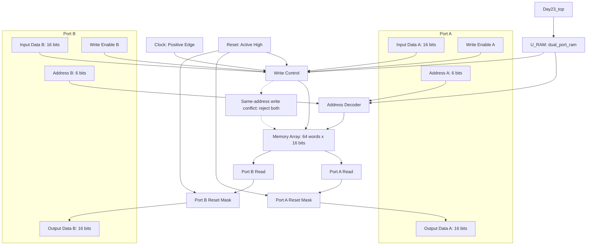

#DAY23- Dual-Port RAM Design and Verification — Verilog RTL & Cadence Genus

<p align="center">
  <b>Digital VLSI • Verilog RTL • Memory Architecture • Functional Verification • ASIC Synthesis</b>
</p>

<p align="center">
  <code>Specification → RTL → Testbench → Simulation → Synthesis → Technology Mapping → Area → Power → Timing → PPA Review</code>
</p>

<p align="center">
  
  
  
  
</p>

---

## 1. Project Information

| Parameter | Details |
|---|---|
| **Project** | Dual-Port RAM Design and Verification |
| **Author** | Omkar Kalmesh Hadapad |
| **Domain** | Digital VLSI / RTL Design / Functional Verification |
| **Design Type** | Dual-port RAM |
| **HDL** | Verilog HDL |
| **Memory Configuration** | 64 words × 16 bits |
| **Total Storage Capacity** | 1,024 bits |
| **Address Width** | 6 bits per port |
| **Data Width** | 16 bits per port |
| **Read Behavior** | Asynchronous read, according to the reviewed specification/log |
| **Write Behavior** | Positive-edge clocked write |
| **Reset** | Active-high; masks outputs and retains memory contents, according to the reviewed specification/log |
| **Simulation Tool** | Cadence NCSim |
| **Synthesis Tool** | Cadence Genus 21.14-s082_1 |
| **Technology Library** | `tsmc18` |
| **Top Module** | `Day23_top` |
| **RAM Instance** | `U_RAM` (`dual_port_ram`) |
| **Reported Functional Checks** | 16 pass, 0 fail |
| **Synthesis Cell Count** | 4,538 standard-cell instances |
| **Reported Cell Area** | 116,596.974 library area units |
| **Reported Power** | 6.85685 mW |
| **Displayed Setup Slack** | +3.560 ns on the previously shared path |
| **Physical Design Status** | Post-route PPA closure not established by the available reports |

> **Measurement note:** The area report provides a library-area sum, but the physical unit is not established in the supplied report. The reported power is for activity frame `/stim#0/frame#0`. The displayed setup slack belongs to one reported path. These values must not be represented as final post-route measurements.

---

## 2. Project Overview

This project implements and verifies a 64-word × 16-bit dual-port RAM. Each port has its own address, input data, write enable, and output data signals. The reviewed specification describes asynchronous reads and writes on the positive edge of the clock.

The reviewed simulation log reports 16 successful checks and no failed checks, followed by a separate `[FAIL] Simulation timeout` message at approximately 800 ns. Therefore, the functional checks reported by the testbench passed, but clean overall simulation termination is not yet established.

The project covers:

- Dual-port memory architecture and data flow.
- Independent Port A and Port B interfaces.
- Address decoding and write-control logic.
- Asynchronous read paths.
- Clocked write behavior.
- Reset output masking and memory retention.
- Same-address write-conflict handling.
- Functional simulation using NCSim.
- Standard-cell synthesis using Cadence Genus.
- Area, power, and setup-timing report interpretation.

---

## 3. Objectives

1. Understand dual-port RAM architecture.
2. Implement a 64 × 16-bit storage array.
3. Verify Port A and Port B read/write operations.
4. Verify independent writes through each port.
5. Check simultaneous writes to different addresses.
6. Verify the specified same-address write-conflict behavior.
7. Verify write-disable behavior.
8. Check asynchronous readback.
9. Verify reset output masking and memory retention.
10. Run functional simulation and inspect the testbench result.
11. Synthesize the design using Cadence Genus.
12. Analyze standard-cell mapping and area distribution.
13. Interpret synthesis power and timing reports.
14. Identify limitations of simulation and synthesis-stage evidence.

---

## 4. RAM Architecture

### Block diagram

## System Architecture Flowchart





If the image is stored elsewhere in the repository, update the path above to match the actual filename.

```text
                         Day23_top
                             |
                             v
                    U_RAM: dual_port_ram
                             |
              +--------------+--------------+
              |                             |
      Address Decode /              WC: write_control
         Selection                         |
              |                             |
              +-------------+---------------+
                            |
                            v
                  Memory Array: 64 × 16
                      Total: 1024 bits
                            |
                 +----------+----------+
                 |                     |
          Port A asynchronous   Port B asynchronous
                 read                  read
                 |                     |
           Reset output mask     Reset output mask
                 |                     |
             dout_a[15:0]          dout_b[15:0]

 Port A: addr_a[5:0], din_a[15:0], we_a
 Port B: addr_b[5:0], din_b[15:0], we_b
 Common controls: clk, rst
```

### Interface summary

| Signal | Width | Function |
|---|---:|---|
| `clk` | 1 bit | Positive-edge write clock |
| `rst` | 1 bit | Active-high reset control |
| `addr_a` | 6 bits | Port A address |
| `din_a` | 16 bits | Port A write data |
| `we_a` | 1 bit | Port A write enable |
| `dout_a` | 16 bits | Port A read data |
| `addr_b` | 6 bits | Port B address |
| `din_b` | 16 bits | Port B write data |
| `we_b` | 1 bit | Port B write enable |
| `dout_b` | 16 bits | Port B read data |

A 6-bit address selects one of 64 locations. Each location stores 16 bits, giving a total capacity of \(64 \times 16 = 1024\) bits.

### Hierarchy

```text
Day23_top
└── U_RAM (dual_port_ram)
    ├── DEC_B (address_decoder)
    └── WC    (write_control)
```

The hierarchy is based on the supplied Genus hierarchy report. The report does not describe all internal net connectivity.

---

## 5. RAM Operation

### Read operation

The reviewed specification describes asynchronous reads: the selected output can respond to an address change without waiting for a rising clock edge, subject to the RTL logic and simulation scheduling.

```text
Address input
     |
     v
Address selection
     |
     v
Memory array
     |
     v
Reset output mask
     |
     v
Read data output
```

### Write operation

Writes are described as positive-edge triggered. A write is accepted according to the port write-enable and conflict-control rules implemented by the RTL.

```text
Write enable + address + input data
                  |
                  v
           Write control
                  |
                  v
          Rising edge of clk
                  |
                  v
             Memory array
```

### Same-address write conflict

The supplied architecture specifies that simultaneous writes to the same address are rejected on both ports. Confirm this behavior against the RTL and the exact testbench checks before treating it as a fully verified specification.

### Reset behavior

The reviewed specification/log describes an active-high reset that masks the read outputs while retaining stored memory contents. This is different from clearing every memory word. Confirm the precise reset behavior against the RTL implementation.

---

## 6. Verification Strategy

The reviewed NCSim transcript reports:

| Verification metric | Reported result |
|---|---|
| Total checks | 16 |
| Passed | **16** |
| Failed | **0** |
| Self-check summary | `PASS` |
| Later simulator message | `[FAIL] Simulation timeout` |
| Termination | `$finish(1)` at `day23_tb.v:399`, approximately 800 ns |

### Scenarios reported as checked

- Read and write operations.
- Independent writes through both ports.
- Simultaneous writes to different addresses.
- Same-address write-conflict handling.
- Write-disable behavior.
- Readback and memory retention through reset.

These are the scenarios described in the reviewed transcript. The report does not establish exhaustive functional coverage or formal equivalence.

### Important verification issue

The log prints a successful 16-check summary and then reports a timeout failure. This suggests that the test sequence may finish its checks without completing the intended simulation shutdown path, but the exact cause cannot be established without inspecting the testbench around line 399 and its watchdog logic.

Before claiming a clean regression pass:

1. Inspect `day23_tb.v` around line 399.
2. Check the ordering of the final summary, completion flag, watchdog, and `$finish`.
3. Re-run the simulation after correcting the termination logic.
4. Confirm that the final run reports 16 passed, 0 failed, and no timeout message.

---

## 7. Genus Synthesis Results

The supplied Cadence Genus report gives the following summary.

| Metric | Reported value |
|---|---:|
| Top module | `Day23_top` |
| Mapped standard-cell instances | **4,538** |
| Total reported cell area | **116,596.974 library area units** |
| Total reported power | **6.85685 mW** |
| Displayed setup slack | **+3.560 ns** |
| Technology library | `tsmc18` |
| Synthesis tool | Cadence Genus 21.14-s082_1 |

These are synthesis-stage results. The available reports do not establish routed interconnect timing or extracted-parasitic post-layout PPA.

---

## 8. Standard-Cell Mapping Analysis

Selected entries from the supplied cell summary:

| Standard cell | Instances | Reported area |
|---|---:|---:|
| `AOI22X1` | 1,536 | 25,546.752 |
| `DFFX1` | 512 | 28,952.986 |
| `DFFHQX1` | 512 | 27,249.869 |
| `OAI222XL` | 512 | 13,624.934 |
| `NAND4X1` | 257 | 4,274.424 |
| `OAI2BB1XL` | 384 | 6,386.688 |
| **Total** | **4,538** | **116,596.974** |

### Sequential versus combinational area

| Category | Instances | Reported area | Share |
|---|---:|---:|---:|
| Sequential | 1,024 | 56,202.855 | 48.2% |
| Inverter | 58 | 385.862 | 0.3% |
| Logic | 3,456 | 60,008.256 | 51.5% |
| Physical cells | 0 | 0 | 0% |
| **Total** | **4,538** | **116,596.974** | **100%** |

### Interpretation

- Sequential cells account for approximately 48.2% of reported cell area.
- `DFFX1` and `DFFHQX1` together account for the largest combined area share.
- `AOI22X1` is the largest individual cell category by area in the supplied cell list.
- The cell population is consistent with a memory implemented using standard cells, but the cell summary alone does not prove the exact inferred memory architecture.

---

## 9. Hierarchy Area Analysis

The hierarchy report gives:

| Hierarchy block | Cell count | Reported area |
|---|---:|---:|
| `Day23_top` | 4,538 | 116,596.974 |
| `U_RAM` (`dual_port_ram`) | 4,538 | 116,596.974 |
| `DEC_B` (`address_decoder`) | 102 | 1,091.059 |
| `WC` (`write_control`) | 9 | 192.931 |

The `DEC_B` and `WC` figures are included within the `U_RAM` total and must not be added to the parent total a second time.

### Main observation

The decoder and write-control blocks represent a small fraction of the total reported area. The remaining memory and selection implementation is therefore the more significant area-optimization target.

The hierarchy report does not provide enough detail to allocate all remaining cells to specific internal functions. Use the mapped netlist and complete reports for a more exact breakdown.

---

## 10. Power Analysis

The supplied Genus power report gives:

| Category | Total power | Share |
|---|---:|---:|
| Register | 6.12386 mW | 89.31% |
| Logic | 0.73300 mW | 10.69% |
| Memory category | 0 mW | 0% |
| Clock category | 0 mW | 0% |
| **Total** | **6.85685 mW** | **100%** |

### Internal, switching, and leakage power

| Component | Reported value | Share |
|---|---:|---:|
| Internal | 6.25225 mW | 91.18% |
| Switching | 0.601536 mW | 8.77% |
| Leakage | 0.00306784 mW | 0.04% |
| **Total** | **6.85685 mW** | **100% approximately** |

### Interpretation

- Register-category power dominates this report.
- Internal power is the largest reported power component.
- Switching power depends on the input and internal signal activity.
- Zero reported power for the separate memory category does not mean the design has no storage-related power; standard-cell storage can be accounted for under the register category.
- The report is associated with activity frame `/stim#0/frame#0`; its representativeness depends on the stimulus and activity annotation.

Before comparing designs, use consistent clocks, input activity, operating conditions, and analysis settings.

---

## 11. Timing Analysis

The supplied setup timing path reports:

| Timing item | Reported value |
|---|---:|
| Path status | **MET** |
| Setup slack | **+3,560 ps = +3.560 ns** |
| Launch clock edge | 0 ps |
| Capture clock edge | 10,000 ps |
| Input delay | 1,000 ps |
| Setup time | 297 ps |
| Clock uncertainty | 1,000 ps |
| Required time | 8,703 ps |
| Data path delay | 4,143 ps |
| Data arrival time | 5,143 ps |

### Reported path

```text
rst input
   |
   v
INVX1
   |
   v
AND2X2
   |
   v
NAND3X1
   |
   v
NOR3X1
   |
   v
NOR2X2  (fanout 65, load 253.1 fF)
   |
   v
INVX1
   |
   v
NOR2X1
   |
   v
NAND2X1
   |
   v
NAND2X1
   |
   v
OAI222XL
   |
   v
U_RAM/mem_reg[57][15]/D
```

The displayed path starts at the reset input and ends at the D pin of a memory storage register.

### Slack calculation

```text
Required time = 8703 ps
Arrival time  = 5143 ps

Slack = Required time − Arrival time
      = 8703 − 5143
      = 3560 ps
      = 3.560 ns
```

The displayed path meets its setup requirement under the supplied constraints.

### Timing interpretation and limitations

- Positive slack means this particular path meets its reported setup requirement.
- A 10 ns capture edge corresponds to 100 MHz only if the clock constraint defines a 10 ns period.
- The `NOR2X2` stage has a reported fanout of 65, load of 253.1 fF, and cell delay of 1,359 ps, making it an important investigation point.
- Review reset logic, fanout, and constraints before choosing an RTL optimization.
- One MET path does not establish that all setup and hold paths meet timing.
- Full timing closure requires complete setup/hold summaries and, for physical closure claims, suitable post-route timing with extracted parasitics.

---

## 12. Recommended Optimization Plan

| Priority | Investigation | Reason |
|---|---|---|
| 1 | Review memory implementation | Storage and selection logic dominate area. |
| 2 | Inspect reset logic and fanout | The previously reported critical path starts at `rst`. |
| 3 | Review read-address selection and write-control logic | These may contribute to combinational area and delay. |
| 4 | Check whether a compatible dual-port SRAM macro is available | A macro may reduce area and power, but depends on the target flow and memory requirements. |
| 5 | Re-run functional verification after each RTL change | Prevent optimization from changing specified behavior. |
| 6 | Re-run Genus area, power, and timing reports with consistent settings | Enables a valid before/after comparison. |

Do not remove reset behavior or alter same-address write handling merely to improve PPA. Preserve the specified functionality and verify each change.

---

## 13. Overall PPA Summary

| Metric | Result | Qualification |
|---|---|---|
| Functional checks | 16 pass / 0 fail reported | Transcript also reports a timeout afterward |
| Mapped cell count | 4,538 | Genus cell summary |
| Total reported area | 116,596.974 area units | Physical unit not confirmed |
| Total reported power | 6.85685 mW | Synthesis-stage estimate |
| Displayed setup slack | +3.560 ns | One setup path |
| Path status | MET | Applies to displayed path |
| Full setup/hold closure | Not established | Complete summaries not supplied |
| Post-route PPA closure | Not established | Routed/extracted reports not supplied |

---

## 14. Suggested Repository Structure

```text
day23-dual-port-ram/
├── README.md
├── rtl/
│   ├── Day23_top.v
│   ├── dual_port_ram.v
│   ├── address_decoder.v
│   └── write_control.v
├── tb/
│   └── day23_tb.v
├── sim/
│   ├── simulation.log
│   └── waveform/
├── genus/
│   ├── constraints.sdc
│   ├── reports/
│   │   ├── hierarchy.rpt
│   │   ├── area.rpt
│   │   ├── power.rpt
│   │   └── timing.rpt
│   ├── mapped_netlist.v
│   └── synthesis.log
├── images/
│   └── dual_port_ram_block_diagram.png
└── docs/
    └── ppa_analysis.md
```

This is a suggested structure. Keep only files that exist in your repository and change filenames to match your actual source files.

---

## 15. Industry Relevance

Dual-port RAM is used where two access interfaces need to read or write a shared storage array under defined collision and timing rules.

This project demonstrates concepts relevant to:

- Synthesizable Verilog RTL.
- Memory architecture and address decoding.
- Sequential and combinational logic.
- Self-checking testbench development.
- Read/write conflict handling.
- Cadence Genus synthesis and technology mapping.
- Standard-cell area analysis.
- Power estimation and activity interpretation.
- Setup timing analysis and critical-path investigation.
- Technical documentation and engineering reporting.

These topics are relevant to entry-level RTL Design, ASIC Design, Design Verification, FPGA Design, and Digital VLSI roles.

---

## 16. Interview Questions

1. What is a dual-port RAM?
2. What is the difference between asynchronous read and synchronous read?
3. How many address bits are required for 64 memory locations?
4. How is total memory capacity calculated?
5. What happens when both ports write to the same address?
6. How is a positive-edge-triggered write implemented in Verilog?
7. What is the difference between output masking and clearing the memory array?
8. Why might a behavioral RAM synthesize into flip-flops and combinational logic?
9. What does technology mapping do?
10. Why does the register category dominate this power report?
11. What are internal, switching, and leakage power?
12. What does positive setup slack mean?
13. Why is a high-fanout net a timing concern?
14. Why is one MET path insufficient to prove timing closure?
15. What additional evidence is needed to claim post-route PPA closure?
16. How would you verify same-address write conflict behavior?
17. How would you reduce area without changing specified behavior?
18. How would you validate an RTL optimization using simulation and Genus?

---

## 17. Project Status

| Stage | Status |
|---|---|
| RTL and architecture summary | Based on supplied project context |
| Functional checks | 16 pass / 0 fail reported |
| Clean simulation termination | Requires timeout investigation |
| Hierarchy report reviewed | Complete for supplied report |
| Standard-cell area reviewed | Complete for supplied report |
| Power report reviewed | Complete for supplied report; activity assumptions need validation |
| Displayed setup path reviewed | Complete for supplied report |
| Full setup/hold timing closure | Not established |
| Post-route PPA closure | Not established |

---

## 18. Author

**Omkar Kalmesh Hadapad**  
Electronics and Communication Engineering

Digital VLSI • Verilog RTL • Functional Verification • Cadence Genus

---

<p align="center">
  <b>Dual-Port RAM — RTL Design, Functional Verification and Synthesis Analysis</b>
</p>
'''
